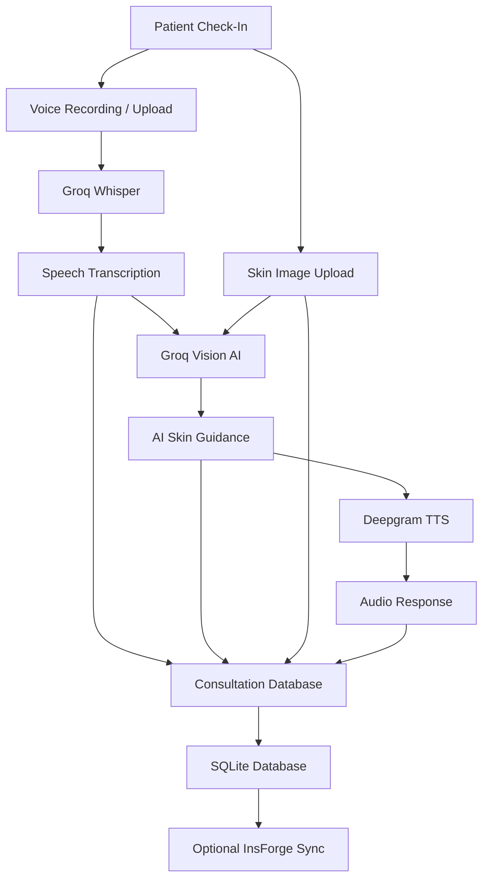

# AI Skin Specialist

<p align="center">
  <strong>An AI-powered skin consultation assistant combining voice input, skin image analysis, AI-generated guidance, and spoken responses.</strong>
</p>

<p align="center">
  
  
  
  
</p>

<p align="center">
  
  
  
  
</p>

---

## Overview

**AI Skin Specialist** is an interactive AI-powered skin consultation assistant built with Python and Gradio. It allows users to describe their skin concerns through voice recordings, upload skin images, and receive AI-generated informational guidance in both text and audio formats.

The application combines speech recognition, multimodal AI analysis, text-to-speech generation, and consultation record storage into a single interface.

> **Disclaimer:** This project provides general informational skin-care guidance. It is not a medical diagnostic system and does not replace consultation with a licensed dermatologist.

---

## Features

- 🎙️ **Voice-Based Symptom Input** – Record or upload audio describing skin-related concerns.
- 📝 **Speech-to-Text Transcription** – Convert patient voice recordings into text using Groq Whisper.
- 🖼️ **AI Skin Image Analysis** – Analyze uploaded skin images using a multimodal AI model.
- 🧠 **AI-Generated Guidance** – Generate conversational skin-care responses.
- 🔊 **Voice Response Generation** – Convert AI-generated responses into audio using Deepgram.
- 👤 **Patient Check-In** – Collect basic patient details before starting a consultation.
- 🎬 **Image & Video Upload Interface** – Upload skin images and videos through the interface.
- 💾 **Consultation Storage** – Save consultation information in a local SQLite database.
- ☁️ **Optional InsForge Cloud Sync** – Sync consultation records to an InsForge database when configured.
- 💻 **Interactive UI** – A custom-designed Gradio interface with a patient intake and consultation workflow.

---

## Tech Stack

<p align="center">
  
  
  
  
</p>

<p align="center">
  
  
  
  
</p>

| Technology | Purpose |
|---|---|
| Python | Core application logic |
| Gradio | Web interface |
| Groq API | AI inference |
| Groq Whisper | Voice transcription |
| Groq Vision Model | Skin image analysis |
| Deepgram | AI response text-to-speech |
| SQLite | Local consultation storage |
| InsForge | Optional cloud database synchronization |
| Pillow | Image processing and resizing |
| FFmpeg | Audio and media processing |
| PortAudio | Microphone/audio support |
| uv | Python package and environment management |

---

## How It Works

1. The patient enters basic details such as name, age and gender.
2. The patient records or uploads a voice description of their skin concern.
3. The patient uploads a skin image for visual analysis.
4. Groq Whisper transcribes the patient's voice into text.
5. The transcribed text and skin image are sent to the Groq vision model.
6. The AI generates a short informational response.
7. Deepgram converts the response into spoken audio.
8. The consultation details are stored locally and optionally synced to InsForge.

---

## System Architecture



---

## Project Structure

```text
AI-SKIN-SPECIALIST/
│
├── main.py
├── app.py
│
├── brain_of_the_doctor_groq.py
├── brain_of_the_doctor.py
│
├── voice_of_the_patient.py
├── voice_of_the_doctor.py
├── free_text_to_speech.py
│
├── database.py
├── schema.sql
│
├── sample.env
├── pyproject.toml
├── uv.lock
├── packages.txt
├── requirements.txt
│
├── sample-image.png
├── test-video.mp4
├── doctor_response.mp3
│
└── stitch_ai_skin_specialist_dashboard/
```

---

## AI & Voice Pipeline

### 1. Patient Voice Transcription

The patient can describe their skin concern through an audio recording.

The application uses Groq's audio transcription API with Whisper to convert the recorded audio into text.

**File:** `voice_of_the_patient.py`

<p>
  
</p>

**Default model:**

```text
whisper-large-v3
```

### 2. AI Skin Analysis

The transcribed symptoms and uploaded skin image are passed to the AI model for contextual analysis.

**File:** `brain_of_the_doctor_groq.py`

The implementation:

- Loads the API key from environment variables.
- Resizes the uploaded image to fit within 1024 × 1024.
- Converts the image into JPEG format.
- Encodes the image into Base64.
- Sends the text and image to a multimodal Groq model.
- Generates a short informational response.

<p>
  
</p>

**Default model configuration:**

```text
qwen/qwen3.8-27b
```

The model is configurable through the `GROQ_MODEL` environment variable.

### 3. AI Voice Response

The AI-generated textual response is converted into spoken audio.

**File:** `voice_of_the_doctor.py`

<p>
  
</p>

**Default voice model:**

```text
aura-2-thalia-en
```

The generated audio is saved as an MP3 file.

### 4. Alternative AI Implementation

The project also includes an alternative implementation:

```text
brain_of_the_doctor.py
```

This implementation uses an Anthropic-compatible API client configured for MiniMax.

It includes image and video handling and is not the currently active AI pipeline in `main.py`.

<p>
  
</p>

---

## Installation

### Prerequisites

- Python 3.11 or newer
- uv
- FFmpeg
- PortAudio
- Groq API key
- Deepgram API key

### 1. Clone the Repository

```bash
git clone https://github.com/tejasmahato2005/AI-SKIN-SPECIALIST.git

cd AI-SKIN-SPECIALIST
```

### 2. Install System Dependencies

#### macOS

```bash
brew install ffmpeg portaudio
```

#### Windows

Using Chocolatey:

```powershell
choco install ffmpeg portaudio
```

Alternatively, use Scoop:

```powershell
scoop install ffmpeg
scoop install portaudio
```

#### Ubuntu / Debian

```bash
sudo apt update

sudo apt install ffmpeg portaudio19-dev python3-dev build-essential
```

#### Fedora

```bash
sudo dnf install ffmpeg portaudio-devel python3-devel gcc gcc-c++ make
```

#### Arch Linux

```bash
sudo pacman -S ffmpeg portaudio base-devel
```

### 3. Install uv

#### macOS / Linux

```bash
curl -LsSf https://astral.sh/uv/install.sh | sh
```

#### Windows

```powershell
powershell -ExecutionPolicy ByPass -c "irm https://astral.sh/uv/install.ps1 | iex"
```

Verify the installation:

```bash
uv --version
```

### 4. Install Python Dependencies

```bash
uv sync
```

This installs the dependencies specified in the project's dependency configuration and lockfile.

---

## Environment Configuration

Create a `.env` file in the root directory.

Copy the template:

```bash
cp sample.env .env
```

Add your API keys:

```env
GROQ_API_KEY=your_groq_api_key
DEEPGRAM_API_KEY=your_deepgram_api_key

WHISPER_MODEL=whisper-large-v3
GROQ_MODEL=qwen/qwen3.8-27b
DEEPGRAM_TTS=aura-2-thalia-en

```
Optional MiniMax Configuration

If you want to use the alternative MiniMax implementation:

```
MINIMAX_API_KEY=your_minimax_api_key
MINIMAX_BASE_URL=https://api.minimax.io/anthropic
MINIMAX_MODEL=MiniMax-M3
```

Optional InsForge Configuration

To enable cloud synchronization:

```
INSFORGE_URL=your_insforge_project_url
INSFORGE_ANON_KEY=your_insforge_anon_key
```
Never commit your .env file or expose your API keys publicly.

Running the Application

Start the application:

```
uv run python main.py
```
The Gradio application will launch locally, usually at:
```
http://127.0.0.1:7860
```
Open the URL in your browser.

Usage

1.Open the application.

2.Enter the patient's name, age and gender.

3.Proceed to the skin consultation interface.

4.Record or upload the patient's voice description.

5.Upload a skin image.

6.Click Analyze Concern.

7.Review the transcribed symptoms.

8.Read the AI-generated guidance.

9.Listen to the generated doctor-response audio.

10.Complete the consultation.

### Media Input Note

The currently active Groq implementation requires a skin image for analysis.

Although the interface supports video uploads, the active Groq pipeline does not directly analyze video. When a video is uploaded alongside an image, the image is used as the visual reference.

The alternative MiniMax-compatible implementation contains separate video handling but is not the active implementation.

### Database & Storage

#### Local Database

The application uses SQLite for local consultation storage.

Database file:
```
consultations.db
```
The database is initialized automatically when the application saves or retrieves consultations.

### Stored Information

| Field | Description |
| :--- | :--- |
| **Patient Name** | Patient's name |
| **Patient Age** | Patient's age |
| **Patient Gender** | Patient's gender |
| **Patient Transcript** | Transcribed voice description |
| **Doctor Guidance** | AI-generated textual response |
| **Image Path** | Reference path for uploaded image |
| **Audio Path** | Generated response audio path |
| **Created At** | Consultation timestamp |
| **InsForge ID** | Optional remote synchronization identifier |


### InsForge Cloud Synchronization

The project supports optional synchronization of consultation records to an InsForge database.

The synchronization implementation:

1.Sends consultation records to the InsForge database endpoint.

2.Supports a PostgREST fallback endpoint.

3.Stores remote synchronization identifiers.

4.Attempts to synchronize pending records when the local database is initialized.

The synchronization feature requires the InsForge URL and anonymous key to be configured.

### Database Schema

The project includes:
```
schema.sql
```
This SQL file contains the PostgreSQL table definition, indexes and Row-Level Security configuration intended for the InsForge database.

Important: The included SQL currently defines public insert and select policies. These are not appropriate for real patient data without additional access-control measures. Do not use the current database configuration to store real medical or sensitive patient information.

## Configuration

| Variable | Description | Default |
| :--- | :--- | :--- |
| `GROQ_API_KEY` | Groq API key | Required |
| `DEEPGRAM_API_KEY` | Deepgram API key | Required |
| `WHATSAPP_MODEL` | Speech transcription model | `whisper-large-v3` |
| `GROQ_MODEL` | Vision AI model | `qwen/qwen3.8-27b` |
| `DEEPGRAM_TTS_MODEL` | Voice generation model | `aura-2-thalia-en` |
| `MINIMAX_API_KEY` | MiniMax API key | Optional |
| `MINIMAX_BASE_URL` | MiniMax API endpoint | `https://api.minimax.io/anthropic` |
| `MINIMAX_MODEL` | MiniMax model | `MiniMax-M3` |
| `INSFORGE_URL` | InsForge project URL | Optional |
| `INSFORGE_ANON_KEY` | InsForge anonymous key | Optional |

### Troubleshooting

### FFmpeg Not Found

Verify that FFmpeg is installed:
```
ffmpeg -version
```
If the command is unavailable, install FFmpeg and restart your terminal.

### PyAudio Installation Errors

Make sure PortAudio is installed.

On macOS:
```
brew install portaudio
```
On Ubuntu/Debian:
```
sudo apt install portaudio19-dev python3-dev build-essential
```
On Windows, ensure PortAudio and Microsoft C++ Build Tools are available if compilation is required.

### Microphone Not Working

1.Check system microphone permissions.

2.Allow microphone access in your browser.

3.Check whether another application is using the microphone.

4.Verify that PortAudio is installed.

### Groq API Errors

Verify that:

1.GROQ_API_KEY is correctly configured.

2.The selected model supports image input.

3.The uploaded image is valid.

4.Your API account has access to the selected model.

### Deepgram Errors

Verify that:

1.DEEPGRAM_API_KEY is configured correctly.

2.The selected TTS model is available.

3.The API request is valid.

### InsForge Sync Errors

Verify that:

1.The InsForge URL is correct.

2.The anonymous key is correctly configured.

3.The consultations table exists.

4.The database policies permit the required operation.

### Security & Privacy

This application handles potentially sensitive information, including voice recordings, skin images and consultation text.

1.Keep API keys in environment variables.

2.Never commit .env files.

3.Avoid uploading identifiable or sensitive patient information to unsecured environments.

4.Review database access policies before enabling cloud synchronization.

5.Implement authentication and authorization before deploying for real users.

6.Define retention and deletion policies for consultation records.

7.Review third-party API data handling policies before transmitting patient information.

This project is intended for experimentation, learning and informational assistance.

### Medical Disclaimer

AI Skin Specialist is an experimental AI-powered skin-care information assistant.

It does not provide medical diagnoses, prescribe medication, or replace a licensed dermatologist.

AI-generated responses may be inaccurate or incomplete. Users should seek professional medical advice for persistent, worsening, painful or concerning skin conditions.

For urgent symptoms, seek immediate medical attention.

### Author

Tejas Mahato

Created and designed as an AI-powered skin consultation assistant integrating speech recognition, multimodal AI, voice generation and consultation storage.

## License

No explicit license is currently specified in this repository. Please contact the repository owner for permission to reuse or distribute the project.

